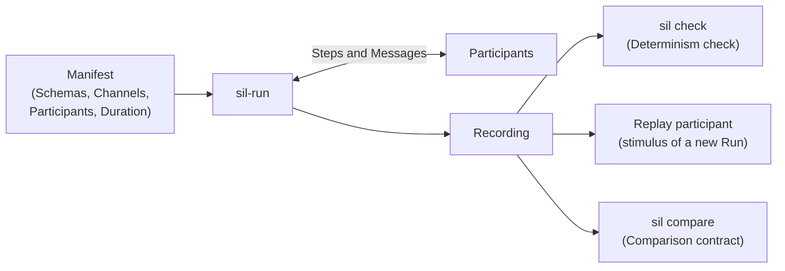
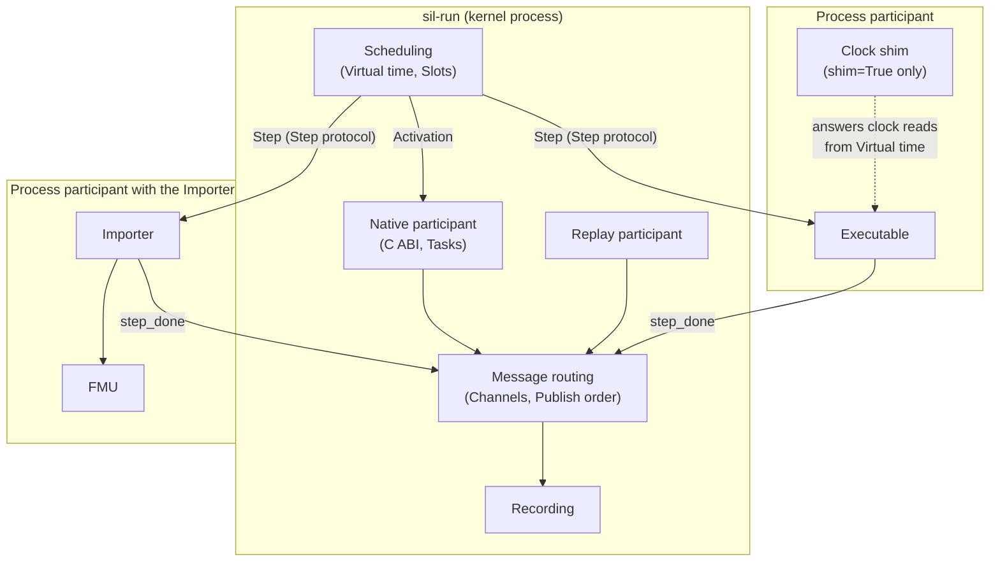
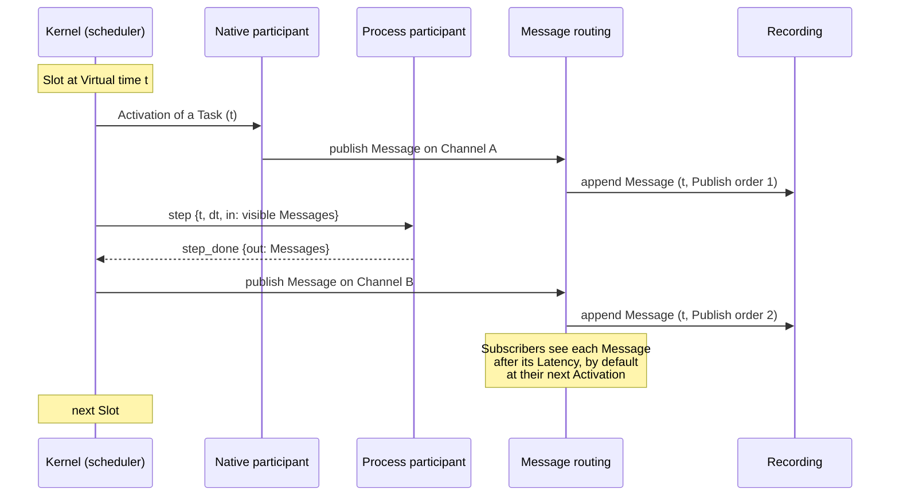
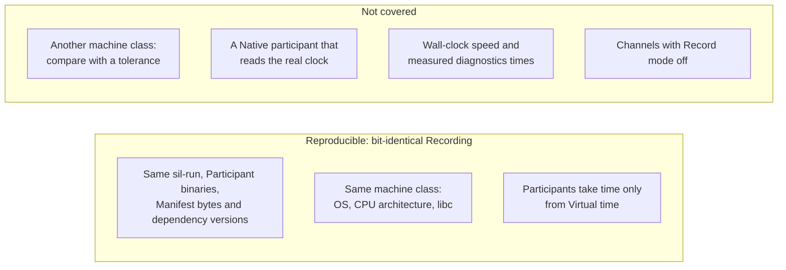

# How SiL works

[Documentation index](README.md) · [Repository overview](../README.md)

This page explains the execution model for a new user. Each term in bold
links to its definition in the [Glossary](../GLOSSARY.md).
To find where a change goes in the code, read the
[architecture guide](architecture.md).

## The workflow

A [**Manifest**](../GLOSSARY.md#runs-and-reproducibility) is the single input of a [**Run**](../GLOSSARY.md#runs-and-reproducibility). It declares the
[**Schemas**](../GLOSSARY.md#data-routing), the [**Channels**](../GLOSSARY.md#data-routing), the [**Participants**](../GLOSSARY.md#participants) and the [**Duration**](../GLOSSARY.md#time-and-scheduling).
`sil-run` executes the Manifest from Virtual time zero to its Duration and
writes a [**Recording**](../GLOSSARY.md#runs-and-reproducibility). Then you examine the Recording:

- `sil check` runs the Manifest twice and bit-compares the two Recordings.
  This is the [**Determinism check**](../GLOSSARY.md#runs-and-reproducibility).
- A [**Replay participant**](../GLOSSARY.md#participants) publishes the Messages of a Recording again, as
  the stimulus of a new Run ([replay](replay.md)).
- `sil compare` compares a Recording with a reference under a
  [**Comparison contract**](../GLOSSARY.md#runs-and-reproducibility) ([comparisons](comparison.md)).

The Manifest hash is the SHA-256 of the exact Manifest bytes. Each Run writes
it into the Recording, so a Recording names the configuration that made it.

## Runtime structure

The kernel does three things: it schedules Participants in [**Virtual time**](../GLOSSARY.md#time-and-scheduling),
it routes [**Messages**](../GLOSSARY.md#data-routing) between them through Channels, and it records each
Message. It does not know what a Participant computes. Each kind of
Participant connects to the kernel through its own interface:

| Participant | Interface to the kernel | Where it runs |
| --- | --- | --- |
| [**Native participant**](../GLOSSARY.md#participants) | The C ABI of [`include/sil/participant.h`](../include/sil/participant.h). It registers [**Tasks**](../GLOSSARY.md#time-and-scheduling) at init. | In the kernel's process |
| [**Process participant**](../GLOSSARY.md#participants) | The JSON-lines [**Step protocol**](../GLOSSARY.md#participants) on stdin and stdout ([Step protocol](step-protocol.md)) | Its own process |
| [**FMU**](../GLOSSARY.md#participants) | The [**Importer**](../GLOSSARY.md#participants) drives the FMU inside a Process participant ([FMI importer](fmi.md)) | The process of that Participant |
| [**Replay participant**](../GLOSSARY.md#participants) | Publishes the Messages of a Recording at their recorded Virtual times | In the kernel's process |

A Process participant with `shim=True` has the [**Clock shim**](../GLOSSARY.md#participants) preloaded. The
shim answers its wall-clock reads and sleeps from Virtual time. A Native
participant has no Clock shim: it must take time only from `now_ns`.

## One Step in Virtual time

The kernel advances Virtual time from one [**Slot**](../GLOSSARY.md#time-and-scheduling) to the next. A Slot is one
instant at which at least one [**Activation**](../GLOSSARY.md#time-and-scheduling) is due. All work in a Slot has
the same Virtual time. A Native participant's Task runs as an Activation. A
Process participant gets a [**Step**](../GLOSSARY.md#time-and-scheduling): a `step` line with the Virtual time `t`,
the elapsed `dt`, and the Messages that are visible to it.

Each Message gets its place in the global [**Publish order**](../GLOSSARY.md#data-routing) when it is
published. The recorder appends each Message in Publish order, and the
kernel routes it to each [**Subscriber route**](../GLOSSARY.md#data-routing) of its Channel. The Channel's [**Latency**](../GLOSSARY.md#data-routing) sets
when a subscriber sees the Message. With the default Latency, the subscriber
sees it at its next Activation, so the execution order inside a Slot cannot
change the outputs.

The [Step protocol](step-protocol.md) defines the lines of a Step. The
[Run contract](running.md#run-contract) defines the exit codes and the
guards of a Run.

## The determinism boundary

**Same artifacts + same machine class ⇒ bit-identical Recordings.** The
guarantee stops there. [SUPPORT.md](../SUPPORT.md#determinism-the-exact-boundary)
gives the exact boundary.

- A rebuild is a new artifact. The guarantee does not cover two builds.
- A Recording from another machine class can differ in its last
  floating-point bit. Compare it with a tolerance, not bit for bit.
- The Clock shim covers only the documented clock reads and sleeps of a
  Process participant with `shim=True`.
- A Channel with [**Record mode**](../GLOSSARY.md#runs-and-reproducibility) `digest` is in the check through its
  SHA-256. A Channel with Record mode `off` is not in the check.
- SiL is not safety-qualified. A passing check is not a safety argument
  ([SUPPORT.md](../SUPPORT.md#not-safety-qualified)).

## Next steps

- Run the ACC example: [examples and installation](getting-started.md#acc-reference-example).
- Select how your system under test joins a Run:
  [choose an integration](integrations.md).
- Onboard a system under test with a coding agent: [agent guide](agent-guide.md).
