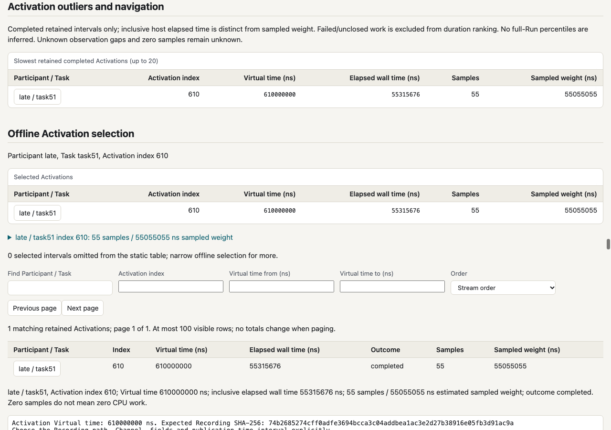

# Retained integrated workflow

[Linux workflow run 41457648886](https://github.com/Stevie1704/sil/actions/runs/41457648886)
passed for source revision `60bae49dd9899e8f1481ac835c391a0ae8a59495`.
The installed wheel and native runners report that revision. The host was
Ubuntu 24.04 x86-64/glibc, kernel `7.0.0-1017-azure`; exact collector/tool
versions and build identities are in the archived profiles. This is a real
perf/Heaptrack capture, not the test fake backends.

`portable-evidence.tar.gz` retains 39 files (36,839,207 uncompressed bytes,
2,425,295 compressed bytes). `archive.sha256` binds the archive;
`contents.json` gives the size and SHA-256 of each member. The archive holds
the CPU/heap portable inputs, explicitly matched diagnostics, Recordings,
query receipts, benchmark summaries, Manifests and GNU time records.
`results.json` is also available without extraction. `rendered-outputs.json`
retains each original HTML output's exact size and digest. Raw process stacks,
binary copies and generated HTML are excluded; regenerate HTML offline.

```sh
cd proofs/actionable-profiling/evidence
sha256sum -c archive.sha256
mkdir /tmp/sil-actionable-evidence
tar -xzf portable-evidence.tar.gz -C /tmp/sil-actionable-evidence
sil profile render /tmp/sil-actionable-evidence/base/profile.json \
  --participant late --task task51 --activation-index 610 \
  --diagnostics /tmp/sil-actionable-evidence/base/run.diagnostics.json \
  --html /tmp/sil-actionable-evidence/selected.html
sil profile diff /tmp/sil-actionable-evidence/base/profile.json \
  /tmp/sil-actionable-evidence/new/profile.json \
  --base-benchmark /tmp/sil-actionable-evidence/base-benchmark/summary.json \
  --new-benchmark /tmp/sil-actionable-evidence/new-benchmark/summary.json \
  --html /tmp/sil-actionable-evidence/diff.html
sil recording query /tmp/sil-actionable-evidence/base/run.mcap \
  --channel events --field task --field index --field publication \
  --from 610000000 --to 611000000 \
  --max-results 104 --max-messages 104 --max-bytes 65536
```

Recorded paths refer to the capture host. They do not need to exist for
offline rendering. To exercise the original minimal contract, copy only
`profile.json`, `cpu/samples.json`, `activation/correlation.json` (CPU) or
`profile.json`, `heap/allocations.json` (heap) elsewhere. Diagnostics and
benchmarks remain explicit opt-in inputs. The query's `source.sha256`
matches the retained Recording artifact; relocating the file changes its
reported path, not its digest or publication identities.

## Results

Both CPU captures retained 32,240 completed intervals, 52 Tasks and the
selected Task 51/index 610 at Virtual time 610,000,000 ns. Each capture's
Recording equaled an ordinary Run of the same Manifest. The BASE/NEW
Manifests and binaries differ and are never claimed byte-identical.

| Selected interval | BASE / full provenance | NEW / external provenance |
| --- | ---: | ---: |
| Inclusive elapsed host ns | 55,315,676 | 27,747,520 |
| Samples | 55 | 28 |
| Estimated sampled weight ns | 55,055,055 | 28,028,028 |
| Leaf source-attributed samples / unknown | 55 / 0 | 28 / 0 |

The independent normalized-stack oracle and static caller/source summaries
agree on these counts/weights. The selected function is `late_spin`. The
heap oracle finds eight allocations/8,192 requested bytes at
`late_allocations` using all normalized rows. Both Recording queries return
104 equal-time publications, ending in `(task,index,publication)` values
`(51,610,0)` and `(51,610,1)`, with complete scan/output and verified digest.
Each side's separate benchmark retains one warm-up and three measured Runs.
The full/external policy difference remains visible in the diff; required
profile artifact hashes remain present under both policies.

GNU time observed selected-render peaks of 92,912/90,812 KiB and elapsed
command times of about 0.97/0.97 seconds. Minimal unselected renders peaked
at 134,776/133,576 KiB and about 1.12/1.17 seconds. The heap render peaked
at 26,096 KiB and about 0.16 seconds. These include a fresh Python process,
input validation and HTML generation. `contents.json` and the resource
records provide exact input sizes and resource observations;
`rendered-outputs.json` records HTML sizes (about 3.7 MiB selected CPU, 6.6 MiB
unselected CPU). None is a threshold, performance prediction, significance
verdict or estimate of target-ECU timing. Nested/inclusive values overlap;
elapsed time and sampled weight are distinct measurements.

Existing legacy/unknown policy, hostile names, recursion, partial/failed,
missing-source and zero-sample fixture checks complement this successful
capture. Collector/environment support still refers to the prior
[native/container qualification](../../profiling-qualification/README.md).
This new evidence does not widen collector or machine-class support.

The screenshot below re-renders the retained BASE evidence after review fixes
in `c319684c`. The recipe starts at the selected Activation's exact Virtual
time. Chrome reported no script errors or network requests.


